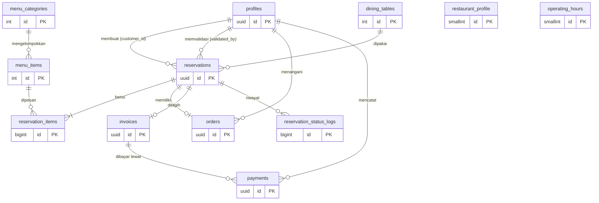

# Dokumentasi Database — Lumière Bar & Resto

Sistem Informasi Restoran dan Reservasi · Supabase (PostgreSQL) · 12 tabel

File migration, dijalankan berurutan:
1. `supabase/migrations/20261031000001_init_schema.sql`: tabel, constraint, trigger, fungsi bisnis.
2. `supabase/migrations/20261031000002_rls_policies.sql`: Row Level Security dan hak akses.
3. `supabase/migrations/20261031000003_storage.sql`: bucket Storage untuk foto menu/restoran.
4. `supabase/migrations/20261031000004_auto_cancel_cron.sql`: jadwal `pg_cron` yang membatalkan reservasi tak divalidasi.

Data contoh ada di `supabase/seed.sql` (terpisah dari migration, dijalankan terakhir).

> **Keputusan stack:** tim mengikuti spreadsheet ketentuan teknis (Next.js + Supabase Auth + Supabase Database + Supabase Storage). Dokumen "Technical Requirements" umum (PostgreSQL murni, tanpa PostgREST, Web Push, worker) tidak dipakai untuk proyek ini. Karena itu Web Push dan background worker tidak dirancang.

---

## 1. ERD



`restaurant_profile` dan `operating_hours` berdiri sendiri (tidak punya FK); keduanya dibaca oleh aturan bisnis di trigger.

## 2. Ringkasan relasi

| Relasi | Jenis | Penjelasan |
|---|---|---|
| `auth.users` — `profiles` | 1 : 1 | Setiap akun login punya tepat satu profil (role, nama, telepon). |
| `profiles` — `reservations` (customer_id) | 1 : N | Satu pelanggan bisa punya banyak reservasi → riwayat kunjungan. |
| `profiles` — `reservations` (validated_by) | 1 : N | Staf/admin yang memvalidasi; boleh kosong. |
| `dining_tables` — `reservations` | 1 : N | Satu meja dipakai banyak reservasi, di waktu yang berbeda. |
| `menu_categories` — `menu_items` | 1 : N | Satu kategori punya banyak menu. |
| **`reservations` — `menu_items`** | **N : M** | Satu reservasi memesan banyak menu; satu menu dipesan banyak reservasi. Dipecah oleh tabel penghubung `reservation_items` (membawa atribut `quantity`, `unit_price`). |
| `reservations` — `orders` | 1 : 1 | Satu reservasi punya satu pesanan (status dapur/penyajian). |
| `reservations` — `invoices` | 1 : 1 | Satu reservasi punya satu tagihan. |
| `invoices` — `payments` | 1 : N | Satu tagihan bisa dibayar bertahap (DP lalu pelunasan). |
| `reservations` — `reservation_status_logs` | 1 : N | Setiap perubahan status tercatat otomatis. |

## 3. Detail tabel

Keterangan: **PK** primary key, **FK** foreign key, **UQ** unique, **NN** not null.

### 3.1 `profiles`
| Kolom | Tipe | Key / Constraint | Keterangan |
|---|---|---|---|
| id | uuid | PK, FK → auth.users, ON DELETE CASCADE | Sama dengan id akun Supabase Auth |
| full_name | varchar(100) | NN, CHECK ≥ 2 karakter | |
| email | varchar(255) | NN, UQ, CHECK format email | |
| phone | varchar(20) | CHECK format nomor Indonesia | |
| role | user_role (enum) | NN, default `pelanggan` | `pelanggan` / `staf` / `admin` |
| is_active | boolean | NN, default true | |
| created_at, updated_at | timestamptz | NN | |

Role **tidak bisa diubah sendiri**: trigger `protect_profile_role` menolak perubahan `role`/`is_active` kecuali oleh admin atau service_role. Trigger `handle_new_user` membuat profil otomatis saat daftar dan **selalu** memberi role `pelanggan`, apa pun isi metadata dari client.

### 3.2 `restaurant_profile` (tepat 1 baris)
| Kolom | Tipe | Constraint |
|---|---|---|
| id | smallint | PK, CHECK id = 1 |
| name | varchar(100) | NN |
| tagline | varchar(200) | |
| description | text | |
| address | text | NN |
| latitude / longitude | numeric(9,6) | CHECK rentang -90..90 / -180..180 |
| phone, email | varchar | |
| logo_path, cover_photo_path | text | Path di Supabase Storage (bukan Base64) |
| min_order_amount | numeric(12,2) | NN, default 300000, CHECK ≥ 0 |
| dp_percentage | smallint | NN, default 50, CHECK 0..100 |
| tax_percentage | numeric(5,2) | NN, default 10, CHECK 0..100 |
| pending_timeout_minutes | smallint | NN, default 30, CHECK 0..1440. Batas waktu validasi staf; 0 = pembatalan otomatis mati |
| updated_at | timestamptz | NN |

Minimal pembelian, persentase DP, dan pajak disimpan di sini agar admin bisa mengubahnya tanpa mengubah kode.

### 3.3 `operating_hours`
| Kolom | Tipe | Constraint |
|---|---|---|
| id | smallint (identity) | PK |
| day_of_week | smallint | NN, UQ, CHECK 0..6 (0 = Minggu) |
| open_time | time | NN |
| close_time | time | NN; `24:00:00` berarti tengah malam |
| is_closed | boolean | NN, default false |

CHECK: jika tidak libur, `open_time < close_time`. Isi awal: 7 baris, 10:00–24:00.

### 3.4 `menu_categories`
| Kolom | Tipe | Constraint |
|---|---|---|
| id | integer (identity) | PK |
| name | varchar(60) | NN, UQ |
| sort_order | smallint | NN, default 0 |
| created_at | timestamptz | NN |

### 3.5 `menu_items`
| Kolom | Tipe | Constraint |
|---|---|---|
| id | integer (identity) | PK |
| category_id | integer | NN, FK → menu_categories, ON DELETE RESTRICT |
| name | varchar(120) | NN |
| description | text | |
| price | numeric(12,2) | NN, CHECK ≥ 0 |
| photo_path | text | Path Supabase Storage |
| is_available | boolean | NN, default true |
| created_at, updated_at | timestamptz | NN |

UNIQUE (category_id, name). Index: `category_id`, `lower(name)` untuk pencarian.

### 3.6 `dining_tables`
| Kolom | Tipe | Constraint |
|---|---|---|
| id | integer (identity) | PK |
| code | varchar(10) | NN, UQ (mis. T1, VIP-1) |
| capacity | smallint | NN, CHECK 1..50 |
| area | varchar(40) | Indoor / Outdoor / VIP |
| is_active | boolean | NN, default true |
| created_at, updated_at | timestamptz | NN |

### 3.7 `reservations` (tabel inti)
| Kolom | Tipe | Constraint |
|---|---|---|
| id | uuid | PK, default gen_random_uuid() |
| reservation_code | varchar(24) | NN, UQ, otomatis `RSV-YYMMDD-00001` → **isi barcode** |
| customer_id | uuid | NN, FK → profiles, RESTRICT |
| contact_name | varchar(100) | NN |
| contact_phone | varchar(20) | NN, CHECK format |
| contact_email | varchar(255) | NN, CHECK format |
| reservation_date | date | NN |
| start_time | time | NN |
| duration_minutes | smallint | NN, CHECK 30..240 dan kelipatan 30 |
| guest_count | smallint | NN, CHECK 1..50 |
| table_id | integer | NN, FK → dining_tables, RESTRICT |
| status | reservation_status | NN, default `menunggu_validasi` |
| validated_by | uuid | FK → profiles, SET NULL |
| validated_at, checked_in_at | timestamptz | |
| rejection_reason | text | wajib terisi jika status `ditolak` |
| notes | text | |
| time_range | tsrange | **generated**: `[tanggal+jam mulai, + durasi)` |
| created_at, updated_at | timestamptz | NN |

Status: `menunggu_validasi → dikonfirmasi → check_in → selesai`, cabang: `ditolak`, `dibatalkan`, `tidak_hadir`. Reservasi `menunggu_validasi` yang melewati `pending_timeout_minutes` otomatis menjadi `dibatalkan` (bagian 8).

Meja dipindah dengan mengubah `table_id`; kapasitas dan benturan jadwal diperiksa ulang, dan hanya reservasi aktif yang boleh dipindah.

Kolom `contact_*` adalah data dari form reservasi (bisa berbeda dari profil, misalnya memesan atas nama orang lain).

### 3.8 `reservation_items` (penghubung N:M)
| Kolom | Tipe | Constraint |
|---|---|---|
| id | bigint (identity) | PK |
| reservation_id | uuid | NN, FK → reservations, ON DELETE CASCADE |
| menu_item_id | integer | NN, FK → menu_items, RESTRICT |
| quantity | smallint | NN, CHECK 1..99 |
| unit_price | numeric(12,2) | NN, CHECK ≥ 0. **Snapshot** harga saat dipesan, diisi trigger dari `menu_items.price` |
| subtotal | numeric(12,2) | generated = quantity × unit_price |
| created_at | timestamptz | NN |

UNIQUE (reservation_id, menu_item_id): satu menu satu baris, jumlah lewat `quantity`. `unit_price` disimpan agar tagihan lama tidak berubah ketika admin mengganti harga menu.

### 3.9 `orders`
| Kolom | Tipe | Constraint |
|---|---|---|
| id | uuid | PK |
| reservation_id | uuid | NN, **UQ**, FK → reservations, CASCADE (inilah yang membuatnya 1:1) |
| status | order_status | NN, default `menunggu` (`menunggu`/`disiapkan`/`disajikan`/`selesai`/`dibatalkan`) |
| handled_by | uuid | FK → profiles, SET NULL |
| notes | text | |
| created_at, updated_at | timestamptz | NN |

Baris dibuat otomatis oleh `generate_invoice()` setelah reservasi divalidasi.

### 3.10 `invoices`
| Kolom | Tipe | Constraint |
|---|---|---|
| id | uuid | PK |
| invoice_number | varchar(24) | NN, UQ, otomatis `INV-YYMMDD-00001` |
| reservation_id | uuid | NN, **UQ**, FK → reservations, RESTRICT |
| subtotal, tax_amount, total_amount, dp_amount | numeric(12,2) | NN, CHECK ≥ 0 |
| payment_status | invoice_status | NN, default `belum_dibayar` (`dp_dibayar`/`lunas`/`dibatalkan`) |
| issued_by | uuid | FK → profiles, SET NULL |
| issued_at, updated_at | timestamptz | NN |

CHECK: `total_amount = subtotal + tax_amount` dan `dp_amount <= total_amount`.

### 3.11 `payments`
| Kolom | Tipe | Constraint |
|---|---|---|
| id | uuid | PK |
| invoice_id | uuid | NN, FK → invoices, RESTRICT |
| type | payment_type | NN (`dp` / `pelunasan`) |
| method | payment_method | NN (`tunai`/`transfer`/`qris`/`kartu_debit`) |
| amount | numeric(12,2) | NN, CHECK > 0 |
| status | payment_record_status | NN, default `berhasil` |
| reference_no | varchar(100) | |
| idempotency_key | varchar(64) | **UQ**: cegah pembayaran ganda saat klik dua kali / retry |
| paid_at | timestamptz | NN |
| recorded_by | uuid | FK → profiles, SET NULL |
| created_at | timestamptz | NN |

### 3.12 `reservation_status_logs`
| Kolom | Tipe | Constraint |
|---|---|---|
| id | bigint (identity) | PK |
| reservation_id | uuid | NN, FK → reservations, CASCADE |
| from_status | reservation_status | null untuk entri pertama |
| to_status | reservation_status | NN |
| changed_by | uuid | FK → profiles, SET NULL |
| note | text | |
| created_at | timestamptz | NN |

Diisi otomatis oleh trigger, tidak ditulis dari aplikasi.

## 4. Pemetaan alur reservasi ke database

| Langkah alur | Yang terjadi di database |
|---|---|
| Login akun | Supabase Auth → trigger membuat baris `profiles` (role `pelanggan`) |
| Isi form (nama, telepon, email, tanggal, jam, durasi, jumlah tamu) | Kolom `contact_*`, `reservation_date`, `start_time`, `duration_minutes`, `guest_count` |
| Pilih meja sesuai kapasitas | Frontend/backend memfilter `dining_tables.capacity >= guest_count` dan meja yang kosong; database menolak jika kapasitas kurang atau jadwal bentrok |
| Pilih menu, minimal Rp300 ribu | Baris `reservation_items`; total dicek saat COMMIT, jika kurang transaksi dibatalkan. Pesan "tidak bisa next" ditampilkan frontend, dan backend + database tetap menolak jika dilewati |
| Kirim reservasi | **Satu panggilan** `supabase.rpc('create_reservation', {...})`: fungsi menyimpan reservasi + semua item dalam satu transaksi. Jangan dibuat dari dua insert terpisah (lihat catatan di bawah) |
| Validasi staf | `status` → `dikonfirmasi`, mengisi `validated_by`/`validated_at`; atau `ditolak` + `rejection_reason` |
| Generate tagihan | `supabase.rpc('generate_invoice', { p_reservation_id })` oleh staf/admin: menghitung subtotal, pajak, total, dan DP 50% dari data DB; juga membuat baris `orders` |
| Bayar DP 50% | Baris `payments` tipe `dp` → `invoices.payment_status` otomatis `dp_dibayar` |
| Pelunasan di tempat | Baris `payments` tipe `pelunasan` → `lunas` |
| Selesai + riwayat + barcode | `status` → `selesai`; riwayat dari `reservations` milik pelanggan; barcode dibuat dari `reservation_code` di frontend (tidak perlu disimpan sebagai gambar) |

## 5. Validasi tiga lapisan (syarat dosen)

Untuk tiap aturan, database menjadi lapisan terakhir yang tidak bisa dilewati. Frontend dan backend (Zod) tetap harus mengulang aturan yang sama dengan pesan error yang ramah.

| Aturan | Frontend | Backend | Database |
|---|---|---|---|
| Field wajib, format email/telepon | ✔ | ✔ Zod | NOT NULL, CHECK regex |
| Harga ≥ 0, jumlah 1..99 | ✔ | ✔ | CHECK |
| Durasi kelipatan 30 menit, maks 4 jam | ✔ | ✔ | CHECK |
| Tamu ≤ kapasitas meja | ✔ filter meja | ✔ | trigger `check_reservation_rules` |
| Dalam jam operasional, tidak lewat tengah malam | ✔ | ✔ | trigger `check_reservation_rules` |
| Tanggal bukan masa lalu | ✔ | ✔ | trigger `check_reservation_rules` |
| Tidak ada benturan jadwal meja | ✔ info ketersediaan | ✔ | **EXCLUDE constraint** `no_double_booking` |
| Minimal pembelian | ✔ blokir tombol Next | ✔ | deferred constraint trigger |
| Transisi status sah | ✔ tombol sesuai status | ✔ | trigger `check_reservation_transition` |
| Tagihan tidak ganda | ✔ | ✔ | UNIQUE `invoices.reservation_id` |
| Pembayaran tidak ganda / tidak berlebih | ✔ cegah klik berulang | ✔ | UNIQUE `idempotency_key`, trigger `sync_invoice_payment_status` |
| Role tidak bisa diubah sendiri | ✔ | ✔ | trigger `protect_profile_role` + RLS |

### Mengapa `create_reservation` berupa fungsi database
Setiap panggilan `supabase.from(...).insert(...)` adalah satu transaksi tersendiri. Aturan minimal pembelian dicek saat COMMIT: jika reservasi dan itemnya dikirim lewat dua insert, insert pertama langsung gagal karena belum ada item. Fungsi `create_reservation(...)` menjalankan keduanya dalam satu transaksi sehingga dicek bersama-sama; kalau gagal, tidak ada baris yang tersisa. Fungsi ini berjalan sebagai pelanggan yang login (SECURITY INVOKER) sehingga RLS tetap berlaku, dan `customer_id` selalu diambil dari `auth.uid()`, bukan dari kiriman client.

Contoh pemanggilan (nilai `p_items` berupa array JSON):

```js
const { data, error } = await supabase.rpc('create_reservation', {
  p_contact_name: 'Budi', p_contact_phone: '081234567890', p_contact_email: 'budi@mail.com',
  p_reservation_date: '2026-11-20', p_start_time: '19:00', p_duration_minutes: 120,
  p_guest_count: 4, p_table_id: 1,
  p_items: [{ menu_item_id: 1, quantity: 2 }, { menu_item_id: 5, quantity: 1 }],
})
```

### Race condition
Dua pelanggan memesan meja yang sama di detik yang sama: constraint `EXCLUDE USING gist` membuat salah satu gagal dengan error `23P01`, tanpa perlu lock manual di aplikasi. Backend cukup menangkap error itu dan menampilkan "Meja sudah dipesan, pilih meja/jam lain". Pembayaran paralel pada satu tagihan diserialisasi dengan `SELECT ... FOR UPDATE` di trigger pembayaran.

> Catatan desain: reservasi berstatus `menunggu_validasi` ikut memblokir meja (supaya tidak terjadi dua pelanggan menunggu meja yang sama). Agar meja tidak tertahan selamanya, reservasi yang tidak divalidasi dalam batas waktu (default 30 menit) dibatalkan otomatis, lihat bagian 8.

## 6. Keamanan dan RLS

| Tabel | Anonim | Pelanggan | Staf | Admin |
|---|---|---|---|---|
| restaurant_profile, operating_hours, menu_*, dining_tables | baca | baca | baca | baca + tulis |
| profiles | — | baca/ubah milik sendiri (kecuali role) | baca semua | semua |
| reservations | — | baca milik sendiri; buat sendiri; batalkan milik sendiri | baca semua; ubah | baca semua; ubah |
| reservation_items | — | baca milik sendiri; tambah saat status menunggu | baca | semua |
| orders, invoices, payments | — | baca milik sendiri | baca + tulis | baca + tulis |
| reservation_status_logs | — | baca milik sendiri | baca | baca |

Tidak ada policy DELETE pada reservasi: data tidak pernah dihapus, hanya diubah statusnya.

Pengingat penting:
- `service_role` (secret key) **melewati RLS**. Kunci ini hanya boleh ada di server lewat environment variable, tidak boleh masuk repo atau kode browser. Skema ini sengaja dibuat agar hampir semua operasi berjalan dengan sesi login pengguna sendiri, sehingga RLS ikut bekerja.
- RLS adalah lapis kedua. Route Handler tetap harus memeriksa login, role, dan kepemilikan data sebelum memproses permintaan.
- `create_reservation` dan `generate_invoice` hanya dapat dipanggil pengguna yang login (hak `anon` dicabut). `generate_invoice` juga menolak pelanggan di dalam fungsinya.
- Aset: foto menu dan logo disimpan di bucket Storage `restaurant-assets` (publik untuk dibaca, hanya admin yang boleh mengunggah/mengubah/menghapus; maks 2 MB; hanya jpeg/png/webp). Tabel hanya menyimpan path, misalnya `menu/steak.webp`. Tema ini tidak punya berkas privat.

## 7. Index

`reservations(customer_id, reservation_date DESC)` untuk riwayat pelanggan, `reservations(reservation_date, start_time)` untuk jadwal staf, `reservations(status)`, `reservations(table_id)`, indeks GiST dari constraint benturan, `menu_items(category_id)`, `menu_items(lower(name))`, `reservation_items(menu_item_id)`, `orders(status)`, `invoices(payment_status)`, `payments(invoice_id)`.

## 8. Keputusan tim dan hal yang masih tersisa

Keputusan yang sudah diambil:

1. **Seed data** ditaruh di file terpisah `supabase/seed.sql`, bukan di folder migration. Migration hanya berisi struktur; seed berisi data contoh (minimal 5 baris per tabel bisnis, semua status, akun uji tiap role) dan dijalankan setelah semua migration. Seed belum dibuat.
2. **Pembatalan otomatis reservasi yang tidak divalidasi.** Reservasi `menunggu_validasi` yang melewati batas waktu (default **30 menit** sejak dibuat) berubah menjadi `dibatalkan` dan mejanya bebas lagi.
   - Batas waktu disimpan di `restaurant_profile.pending_timeout_minutes` (0 = dimatikan), jadi admin dapat mengubahnya tanpa mengubah kode.
   - Dijalankan tiap menit oleh `pg_cron` (migration 4) lewat fungsi `expire_pending_reservations()`. Fungsi ini tidak bisa dipanggil pengguna aplikasi.
   - Riwayat status mencatat alasannya ("Dibatalkan otomatis: tidak divalidasi staf dalam 30 menit"), dengan `changed_by` kosong karena dilakukan sistem. UI dapat menampilkannya ke pelanggan.
   - Jika staf memvalidasi tepat saat batas waktu tiba, validasi staf yang menang; reservasi yang sudah `dikonfirmasi` tidak ikut dibatalkan.
   - Meja baru bebas paling lama 1 menit setelah batas waktu lewat, karena pembatalan berjalan tiap menit.
3. **Perpindahan meja** cukup dengan `UPDATE reservations SET table_id = ...` oleh staf/admin, tanpa tabel riwayat khusus. Database tetap memeriksa kapasitas, meja aktif, jam operasional, dan benturan jadwal. Tambahan aturan: meja hanya bisa dipindah untuk reservasi yang masih aktif (`menunggu_validasi`, `dikonfirmasi`, `check_in`). Konsekuensi: siapa yang memindahkan dan dari meja mana tidak tercatat.

Yang masih perlu diperhatikan:

- **Batas 30 menit dihitung 24 jam**, padahal staf hanya bertugas pada jam operasional (10.00-00.00). Reservasi yang dibuat pukul 23.50, atau dini hari saat tidak ada staf, otomatis batal sebelum ada yang sempat memvalidasi. Beri tahu pelanggan di UI ("akan dibatalkan otomatis jika tidak divalidasi dalam 30 menit"), atau pertimbangkan menghitung batas waktu hanya selama jam operasional.
- **Data dummy status `menunggu_validasi` akan ikut dibatalkan** setelah 30 menit. Untuk demo, set `pending_timeout_minutes = 0` agar data contoh bertahan, atau buat reservasi baru sesaat sebelum didemokan. Tanyakan ke dosen apakah pembatalan otomatis perlu didemokan atau cukup dijelaskan.

## 9. Cara menjalankan

Lihat `docs/panduan-supabase-nextjs.md` untuk langkah lengkap membuat project Supabase, menjalankan keempat migration, dan menyambungkannya ke Next.js.

Catatan pengujian: migration 1 dan 2 sudah diuji di PostgreSQL 16 (dengan schema `auth` tiruan), termasuk pemanggilan fungsi sebagai peran `authenticated`/`anon` dan logika pembatalan otomatis. Migration 3 (Storage) dan 4 (penjadwalan `pg_cron`) belum bisa diuji di luar Supabase. Setelah dijalankan, periksa bucket di dashboard dan jadwal dengan `SELECT * FROM cron.job;`.
